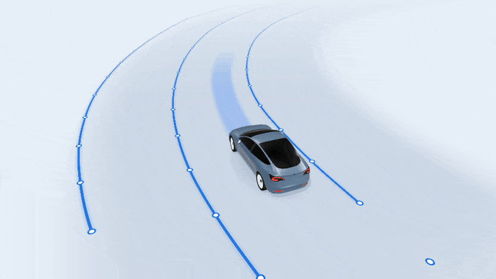
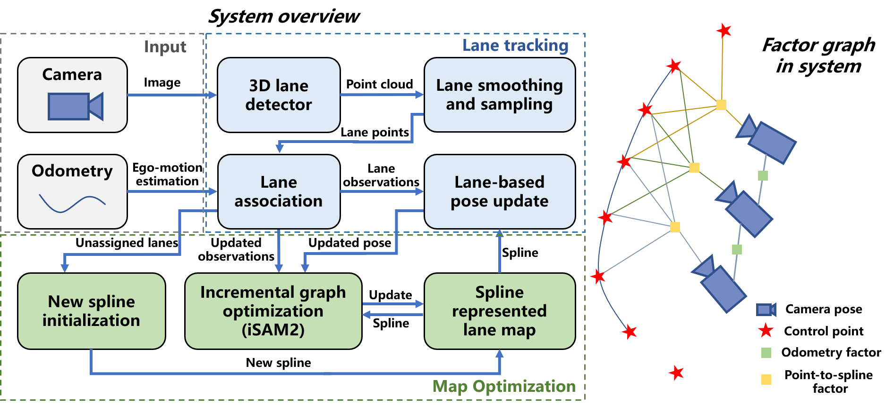

<div align="center">
    
</div>
<div align="center">
<a href="https://arxiv.org/abs/2307.11653"></a>
<a ></a>
<a href="https://github.com/HKUST-Aerial-Robotics/MonoLaneMapping/stargazers">

</a>
<a href="https://github.com/HKUST-Aerial-Robotics/MonoLaneMapping/network/members">

</a>
<a href="https://github.com/HKUST-Aerial-Robotics/MonoLaneMapping/issues">

</a>
</div>

<p align="center">
  
</p>
<p align="center">
  <sub>Recorded OpenLane trajectory, mapped lane splines, and control points. Tesla Model 3 by <a href="https://sketchfab.com/3d-models/tesla-model-3-123c10f376ec4f18b93c73afc382808b">David_Holiday</a>, recolored and animated for this demo under <a href="https://creativecommons.org/licenses/by/4.0/">CC BY 4.0</a>.</sub>
</p>

## Introduction

This is the official code repository of "Online Monocular Lane Mapping Using Catmull-Rom Spline", which is accepted by IROS'23.

MonoLaM (Monocular Lane Mapping) is an online lane mapping algorithm based on a monocular camera. It takes real-time images and odometry (such as from VIO), and estimates its own pose as well as the lane map. 

Its main features are:
+ MonoLaM uses a monocular 3D lane detection network to obtain 3D lane marking measurements.
+ Lane association using a combination of Chamfer distance, pose uncertainty, and lateral sequence consistency.
+ The lane marking is parameterized by the Catmull-Rom Spline, which saves the map memory.
+ Initializing control points for unordered lane line point clouds.
+ Incrementally extending and optimizing the lane map.



## Installation

Use Python 3.10 on Linux. Install the Python dependencies in a virtual environment.

```bash
uv venv --python 3.10 .venv
uv pip install --python .venv/bin/python -r requirements.txt
source .venv/bin/activate
```

## Run the bundled example

```bash
python examples/demo_mapping.py --cfg_file config/lane_mapping.yaml --output_dir /tmp/monolam-demo
python examples/view_map.py /tmp/monolam-demo/visualization/*/map.npy /tmp/monolam-demo/map.html
```

Open `map.html` in a browser to orbit the 3D map and toggle individual lanes, control points, and raw detections. The HTML works offline. Use `--bag /path/to/segment.bag` to replay another recording or `--debug_mode` to open the Open3D desktop viewer on a machine with a display.

## OpenLane benchmark

Download the [OpenLane validation annotations](https://github.com/OpenDriveLab/OpenLane/blob/main/data/README.md) and the published `.bag` recordings. The recordings contain the PersFormer predictions, lane ground truth, and camera poses. The camera coordinate system is X forward, Y left, Z up.

Download the recordings from [OneDrive](https://hkustconnect-my.sharepoint.com/:u:/g/personal/zqiaoac_connect_ust_hk/EQxCBwl1Wc5Foq1wNOJ7ZKQBrNik0GK_qa7qEed_zrbGmQ?e=bYSYvk) or [Baidu Cloud](https://pan.baidu.com/s/1Hrd8ashoiB4_f0B-iz6OHQ?pwd=2023).

```text
OpenLane/
  lane3d_1000/
    rosbag/       # 202 validation recordings
    validation/   # OpenLane JSON annotations by segment
    test/         # scene JSON directories or the published 1000_*.txt manifests
```

```bash
DATA=/path/to/OpenLane
RUN=/tmp/monolam-benchmark
python examples/mapping_bm.py --cfg_file config/lane_mapping.yaml --dataset_dir "$DATA" --output_dir "$RUN/mapping"
python examples/openlane_eval3d.py --cfg_file config/lane_mapping.yaml --dataset_dir "$DATA" --output_dir "$RUN/mapping"
python examples/lane_association.py --cfg_file config/lane_association.yaml --dataset_dir "$DATA" --output_dir "$RUN/association" --bm
```

For Table I in the [paper](https://arxiv.org/abs/2307.11653), set `lane_asso.yaw_std: 2` and `lane_asso.trans_std: 3` in a copy of `config/lane_association.yaml`. The bundled configuration uses 5 degrees and 5 m.

For Table II, run `mapping_bm.py --eval_pose` with `pose_update.add_odo_noise: true` and set the yaw, X and Y entries of `pose_update.odom_noise` to each value from 0.1 to 0.5 in steps of 0.1. For Table IV, run both mapping and evaluation with `preprocess.drop_prob` set to 0.0, 0.4, 0.6, and 0.8. Use a separate output directory for each run.

The curve-fitting toy example is available with `python examples/demo_curve_fitting.py`.

## Citation
If you find this work useful in your research, please consider citing:
```
@inproceedings{qiao2023online,
  title={Online monocular lane mapping using catmull-rom spline},
  author={Qiao, Zhijian and Yu, Zehuan and Yin, Huan and Shen, Shaojie},
  booktitle={2023 IEEE/RSJ International Conference on Intelligent Robots and Systems (IROS)},
  pages={7179--7186},
  year={2023},
  organization={IEEE}
}
```

## License
This project is licensed under the MIT License - see the [LICENSE](LICENSE) file for details.
